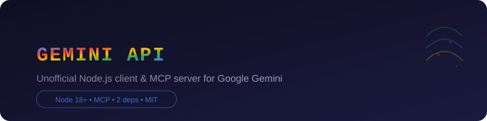

<p align="center">
  
</p>

<p align="center">
  
  
  
  
  
</p>

<p align="center">
  <a href="#quick-start">Quick Start</a> •
  <a href="docs/guide.md">Guide</a> •
  <a href="docs/api.md">API</a> •
  <a href="docs/protocol.md">Protocol</a>
</p>

---

<p align="center">
  <strong>Unofficial reverse-engineered Node.js client for Google Gemini</strong>
  <br>
  No login required for text & images — cookies unlock Google Veo video generation and the full account suite.
  <br>
  Drop a <code>cookies.json</code> and use.
</p>

---

## Quick Start

```sh
git clone https://github.com/etrnkz/gemini-unofficial-api.git
cd gemini-unofficial-api
npm install
```

```js
import { GeminiClient } from './src/gemini.js';

const gemini = new GeminiClient();
const answer = await gemini.sendMessage('What is the capital of France?');
console.log(answer);
// The capital of France is Paris.
```

## At a Glance

| Area | Methods | Auth |
|------|---------|------|
| Chat | `sendMessage`, `streamMessage` | none |
| Images | `sendImage`, `streamImage` | none |
| Files | `uploadFile`, `uploadBuffer`, `sendMessageWithFiles` | none |
| Video analysis | `sendVideo`, `streamVideo` | none |
| Video generation | `generateVideo`, `waitForVideo`, `downloadVideo` | cookie |
| Accounts | `listAccounts`, `useAccount`, `rotateAccount`, `addAccount` | optional |
| Chats | `listChats`, `readChat`, `deleteChat`, `renameChat`, `generateChatTitle` | cookie |
| Gems | `listGems`, `createGem`, `updateGem`, `deleteGem` | cookie |
| Memory | `listMemories`, `createMemory`, `updateMemory`, `deleteMemory`, `deleteAllMemories` | cookie |
| Account | `listModels`, `getAccountStatus`, `getSettings`, `getUsageInfo`, `checkQuota` | optional |
| Research | `getDeepResearchCaps`, `deepResearchBootstrap` | cookie |
| Media | `downloadFile`, `getFullSizeImage` | optional |

## Docs

| | |
|---|---|
|  [Guide](docs/guide.md) | Step-by-step usage: guest mode, login, file/video ops, Veo video generation, multi-account |
|  [API Reference](docs/api.md) | Full docs for all methods with parameters and return types |
|  [Protocol](docs/protocol.md) | How the reverse-engineered protocol works under the hood |

## License

MIT &copy; [etrnkz](https://github.com/etrnkz)
